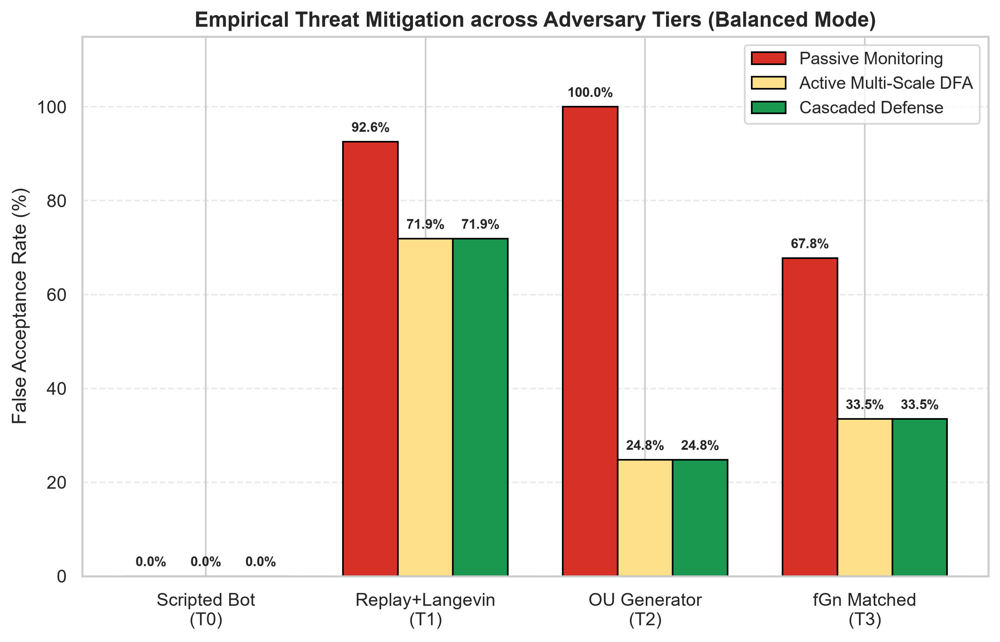
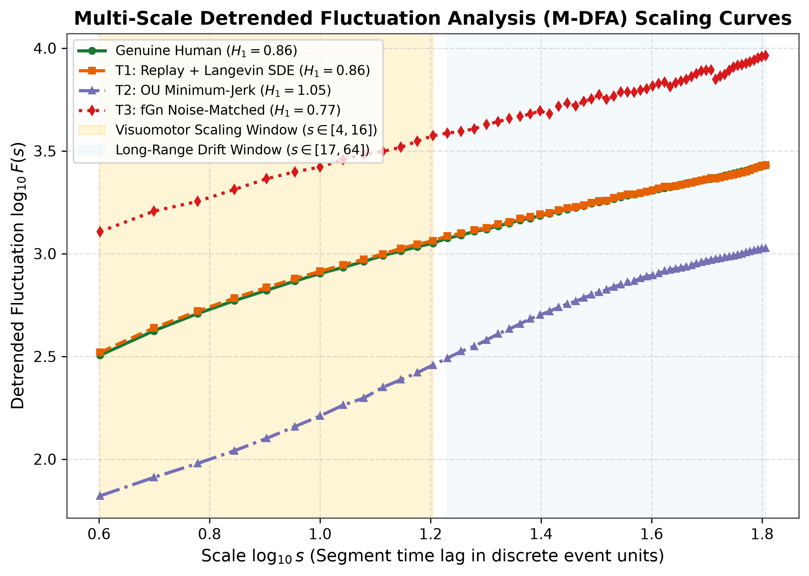
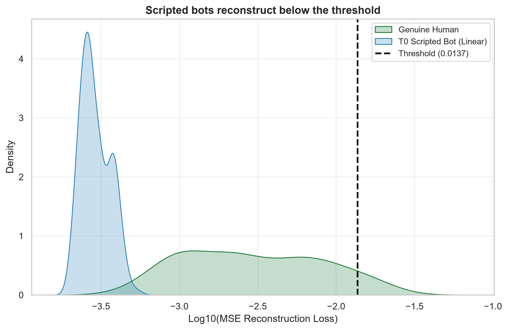

# Agentic Continuous Authentication Against Behavioral Deepfakes

Code and frozen evaluation artefacts for the Master's thesis ***Agentic Defense Against Biological Behavioral Deepfakes*** (MACS 999, School of Computer Science, University of Wollongong in Dubai) and the companion article ***Agentic Multi-Agent Continuous Authentication Against Biologically Augmented Behavioral Deepfakes: Multi-Scale Detrended Fluctuation Analysis and Oracle Bounds*** by M. Abouzithar, G. Tsaramirsis, M. Kumar, and M. Dordevic. A preliminary conference paper introducing the conceptual framework was presented at ICSPIS 2026 on 11 November 2026 and is in press.

---

## 1. Overview & System Components

- **Passive baseline (`src/classifier_baseline.py`):** `BehaveFormerMAE`, a 4-layer Transformer masked one-class autoencoder ($d_{\text{model}} = 64$, $4$ attention heads, $15\%$ training token masking) trained exclusively on genuine mouse trajectories (`257` raw events $\to$ `256` kinematic steps of $(\Delta x, \Delta y, v, a)$).
- **Four open-loop attacker tiers (`src/attackers.py`):**
  - **T0 (`scripted_bot`):** Constant-speed straight-line interpolation between the window endpoints ($\sigma_v = 0$).
  - **T1 (`replay_langevin`):** Stolen genuine test trajectory perturbed by a first-order Ornstein–Uhlenbeck (overdamped Langevin) positional process ($\theta = 200\text{ s}^{-1}, \sigma_0 = 7.9\text{ px}/\sqrt{\text{s}}, \kappa = 1.0$).
  - **T2 (`ou_generator`):** Fifth-order minimum-jerk polynomial synthesis across $K \in \{3, 4, 5\}$ waypoints sampled from the victim's training profile, superposed with continuous OU positional tremor.
  - **T3 (`fgn_matched`):** Fractional Gaussian noise speed synthesis (Davies–Harte algorithm) matched to each victim's training-split mean Hurst exponent $\bar{H}_1$, log-speed moments, and step-angle increments.
- **Multi-Scale Detrended Fluctuation Analysis (`src/dfa.py`):** Linear-detrending DFA-1 over $s \in [4, 64]$, extracting the short-range scaling exponent $H_1$ ($s \in [4, 16]$), long-range scaling exponent $H_2$ ($s \in [17, 64]$), scale-crossover gap $\Delta H = H_1 - H_2$, short-scale fluctuation magnitude $\ell_F = \log_{10} F(4)$, and speed standard deviation $\sigma_v$.
- **Deterministic LangGraph defense (`src/defensive_mas.py`):** Five-node, LLM-free state machine (`monitoring` $\to$ `probe_50ms` $\to$ `analysis` $\to$ `decision` $\to$ `stage2_oracle_escalation`) with structured per-decision audit logging.
- **Classical one-class baselines (`src/evaluate_classical_baselines.py`):** One-Class SVM, Local Outlier Factor (LOF), Isolation Forest, and Gaussian Mixture Model trained on 6 summary kinematic statistics from the same 517 genuine training windows.
- **Supplementary unimodal checks (`experiments/unimodal_sandbox/`):** Static $H_1$ positional-noise sensitivity on Balabit Mouse Dynamics (`user12`, 233 sessions) and ACT-R cognitive fatigue numerical stability on CMU Keystroke Dynamics (51 subjects, 20,400 repetitions).
- **Interactive web simulator (`src/api/main.py`, `webapp/`):** FastAPI Server-Sent Events (SSE) backend and React + TypeScript dashboard streaming held-out test windows through the trained autoencoder and LangGraph state machine.

---

## 2. Measurement Scope & Stage 2 Oracle Framing

The SU-AIS BB-MAS dataset was recorded without interactive cursor-latency perturbations:

1. **Stage 1 (Measured, Label-Blind):** Evaluates `BehaveFormerMAE` reconstruction error, the kinematic variance gate ($\sigma_v \ge 10\text{ px/s}$), and the multi-scale DFA cascade ($H_1, \Delta H, \ell_F$) directly on the recorded test trajectories. Stage 1 never accesses ground-truth class labels (`response_source: "observed_window"`).
2. **Stage 2 (Analytical Oracle Upper Bound):** When a window passes the passive gate and satisfies $\Delta H$ and $\ell_F$ but has a borderline short-range exponent $H_1 \in [H_1^* - 0.05, H_1^*)$, the graph transitions to `stage2_oracle_escalation` (150 ms step-up challenge, Thesis Sections 3.6.5 and 3.8.3). Because offline recordings contain no user reactions to a real 150 ms cursor lag, Stage 2 resolves escalated windows via an explicit analytical oracle (`oracle_upper_bound: true`), recovering escalated genuine sessions ($\text{FRR}: 28.10\% \to 22.31\%$) and revoking escalated attacks ($\text{FAR}$ unchanged at $32.54\%$).

---

## 3. Main Benchmark Results

### Dataset Split (Chronological, Leak-Free per Subject)
- **Subjects:** `92` validated desktop subjects from SU-AIS BB-MAS (`117` raw subjects; `25` excluded for having $< 3$ windows after 30 s idle-gap segmentation).
- **Genuine windows (`926` total):** `517` train ($60\%$) $\cdot$ `167` validation ($20\%$) $\cdot$ `242` test ($20\%$).
- **Attack test windows (`968` total):** `242` per tier across T0, T1, T2, and T3.
- **Total evaluated test windows:** **`1,210`** (`242` genuine + `968` attack). All normalizer parameters are fitted on the `517` training windows, and all decision thresholds are calibrated on the `167` validation windows.

### Test-Set Performance Across Detectors ($N = 1{,}210$ Windows)

| Method | Genuine FRR (%) | FAR T0 (%) | FAR T1 (%) | FAR T2 (%) | FAR T3 (%) | Overall FAR (%) | Balanced Error (%) |
|---|---:|---:|---:|---:|---:|---:|---:|
| `BehaveFormerMAE` (one-sided passive + $\sigma_v$ gate) | 7.44 | 0.00 | 92.56 | 100.00 | 67.77 | 65.08 | 36.26 |
| `BehaveFormerMAE` (two-sided passive $[P_5, P_{95}]$) | 9.09 | 0.00 | 90.91 | 65.29 | 67.77 | 55.99 | 32.54 |
| **Stage 1 M-DFA Cascade (Path A, Balanced)** | **28.10** | **0.00** | **71.90** | **24.79** | **33.47** | **32.54** | **30.32** |
| **Two-Stage with Oracle Stage 2 (Path B)** | **22.31** | **0.00** | **71.90** | **24.79** | **33.47** | **32.54** | **27.43** |
| One-Class SVM (6 summary features) | 16.94 | 0.00 | 83.06 | 3.72 | 0.00 | 21.69 | 19.32 |
| Local Outlier Factor (6 summary features) | 9.92 | 0.00 | 90.08 | 9.50 | 0.00 | 24.90 | 17.41 |
| Isolation Forest (6 summary features) | 12.81 | 2.07 | 87.60 | 35.54 | 0.00 | 31.30 | 22.06 |
| Gaussian Mixture Model (6 summary features) | 12.40 | 46.28 | 87.60 | 65.70 | 0.00 | 49.90 | 31.15 |

### Stage 1 Operating Regimes (Validation-Calibrated)

| Regime | $H_1^*$ | $\Delta H_{\min}$ | $\ell_{\min}$ | Genuine FRR (%) | FAR T0 (%) | FAR T1 (%) | FAR T2 (%) | FAR T3 (%) | Overall FAR (%) |
|---|---:|---:|---:|---:|---:|---:|---:|---:|---:|
| **Frictionless** ($P_{10}$) | 0.6146 | — | — | 18.60 | 0.00 | 81.82 | 100.00 | 50.41 | 58.06 |
| **Balanced** ($P_{15}$) | 0.6443 | 0.08 | 1.85 | 28.10 | 0.00 | 71.90 | 24.79 | 33.47 | 32.54 |
| **High-Security** (Val EER) | 0.9058 | 0.12 | 2.00 | 57.85 | 0.00 | 41.74 | 9.92 | 11.57 | 15.81 |

<p align="center">
  
</p>

<p align="center"><em>Attack FAR per tier (Balanced Mode). The Stage 1 cascade halves overall FAR from 65.08% to 32.54% (McNemar χ² = 313.00, p = 4.84 × 10⁻⁷⁰) but leaves T1 replay at 71.90%, matching the genuine acceptance rate (71.90%) at the same operating point.</em></p>

### Key Empirical Findings

- **The Defensive Gap (Inverted Passive Scoring):** One-sided passive reconstruction error ranks smooth synthetic attacks as *more normal* than genuine human motion (`ROC AUC = 0.3622`, 95% CI `0.3303–0.3932`; one-way ANOVA across Genuine, T0, and T2 MSE: $F(2, 723) = 173.25, p = 3.38 \times 10^{-62}$). Enforcing a post-hoc two-sided interval $[P_5, P_{95}] = [0.000568, 0.0137]$ eliminates T0 without the variance gate, cuts passive T2 FAR to `65.29%`, and raises continuous log-deviation ROC AUC to `0.7186` (95% CI `0.6868–0.7497`), while two-thirds of T2 windows still require M-DFA gating.
- **Multi-Scale Crossover Carries the Separation:** On its own, the short-range Hurst exponent $H_1$ reaches `ROC AUC = 0.5982` across all tiers (`T0` scored as `0.0`) and `0.4642` across the non-trivial tiers `T1–T3` (`T1: 0.5015`, `T2: 0.2241`, `T3: 0.6672`), falsifying the naive $H_1 \approx 0.5$ hypothesis. It is the scale-crossover gate ($\Delta H = H_1 - H_2 \ge 0.08$) and fluctuation-magnitude gate ($\ell_F = \log_{10} F(4) \ge 1.85$) that reduce T2 FAR from `100.00%` to `24.79%` and T3 FAR from `67.77%` to `33.47%`.
- **The Replay Ceiling:** Because T1 replay copies a genuine trajectory and adds small mean-reverting positional jitter ($\theta = 200\text{ s}^{-1}$), its features match the source window almost identically ($H_1 = 0.8634 \pm 0.1771$ vs. $0.8639 \pm 0.1774$ for genuine). Across every static detector evaluated—neural, fractal, or classical—T1 FAR tracks the genuine acceptance rate ($1 - \text{FRR}$) to within a single window.
- **Classical Baselines Outperform on Parametric Synthesis:** Simple one-class detectors on 6 window-level summary statistics reject `90.50%–96.28%` of T2 and `100.00%` of T3 at lower FRR (`9.92%` for LOF), but still accept `83.06%–90.08%` of T1 replays, confirming that closing the replay gap requires an interactive closed-loop challenge.

<p align="center">
  
</p>

<p align="center"><em>Cohort-averaged M-DFA fluctuation curves. The T1 replay curve lies on top of the genuine curve; T2 minimum-jerk is over-smoothed with the lowest short-scale fluctuation and a steep long-range slope; T3 fGn has the highest fluctuation floor and shallowest slope.</em></p>

<p align="center">
  
</p>

<p align="center"><em>Log-scale reconstruction error distributions for genuine windows and T0 scripted bots. Constant-speed linear trajectories reconstruct with lower MSE than genuine motion (max T0 MSE = 0.000548 vs. τ = 0.0137) and are rejected by the kinematic variance gate (σ_v = 0).</em></p>

Full inferential statistics and ablation tables are in [`docs/RESULTS.md`](docs/RESULTS.md).

---

## 4. Reproducing the Benchmark & Figures

The pipeline is tested on Python 3.12+ (exact dependency pins are in [`requirements-lock.txt`](requirements-lock.txt)).

```bash
pip install -r requirements.txt

# 1. Recompute all inferential statistics (ANOVA, Tukey HSD, Fisher, McNemar, B=10,000 bootstrap CIs, two-sided MSE)
#    Runs directly from frozen reports/evaluation_results.csv (no raw dataset download required):
python src/statistical_tests.py

# 2. Regenerate all publication and analysis figures from frozen reports/ artefacts:
python src/generate_manuscript_figures.py
python src/visualize_results.py

# 3. Run the 14 unit and leakage-audit tests:
python -m pytest tests/
```

To re-run the full training and windowing pipeline from raw data (`src/run_experiments.py` and `src/evaluate_classical_baselines.py`), download the public **SU-AIS BB-MAS** dataset (Belman et al., 2019, IEEE Dataport) and place the subject folders (`1/`, `2/`, ...) under `data/raw/bb_mas/BB-MAS_Dataset/`:

```bash
python src/run_experiments.py
python src/evaluate_classical_baselines.py
python experiments/unimodal_sandbox/run_unimodal_validation.py
```

### Notes on `reports/evaluation_results.csv`
- Contains `1,210` rows (`242` genuine and `968` attack test windows).
- **`h1` stores the Stage 1 physical exponent (`h2 + delta_h`, oracle-free):** Verified to match `h2 + delta_h` to machine precision across all `41` escalated windows (`14` genuine, `14` T1, `13` T3). Constant-speed T0 windows have `std_v = 0.0` and undefined DFA (`NaN`), scored as `0.0` in all-tier ROC computation.

---

## 5. Interactive Web Simulator (FastAPI + React)

The web simulator (`src/api/main.py` + `webapp/`) streams real held-out BB-MAS test windows and synthesized T0–T3 attacks through `BehaveFormerMAE` and the 5-node LangGraph defense state machine using the exact benchmark thresholds (`checkpoints/thresholds.json`).

```bash
uvicorn src.api.main:app --reload --port 8000
cd webapp && npm install && npm run dev
```

- On Windows, `.\start_dashboard.ps1` launches both servers simultaneously.
- Supports direct window deep-linking for deterministic demonstrations:
  - `http://localhost:5173/simulator?window=103` — locks **Subject 57, Window 19** (canonical Stage 1 example: Genuine and T1 authenticated; T0 and T2 revoked).
  - `http://localhost:5173/simulator?window=2` — locks **Subject 5, Window 4** (borderline $H_1 = 0.620 \in [0.5943, 0.6443)$, demonstrating Stage 2 oracle escalation).

---

## 6. Repository Layout

```text
src/
  pipeline.py                      Chronological 60/20/20 windowing, 30 s gap segmentation, train-only Normalizer
  attackers.py                     Open-loop attacker tiers T0, T1, T2, T3 and VictimProfile
  dfa.py                           DFA-1 fluctuation function F(s) and multi-scale features (H1, H2, ΔH, ℓ_F, σ_v)
  defensive_mas.py                 Deterministic 5-node LangGraph state machine and Stage 2 analytical oracle
  classifier_baseline.py           BehaveFormerMAE masked one-class Transformer autoencoder
  offensive_engine.py              Cross-modal GAN-VAE architectural scaffold and BiologicalDecayModule
  run_experiments.py               End-to-end training, validation calibration, and test benchmark runner
  evaluate_classical_baselines.py  OC-SVM, LOF, Isolation Forest, and GMM benchmark evaluation
  statistical_tests.py             ANOVA, Tukey HSD, Fisher, McNemar, bootstrap CIs (B=10,000), two-sided MSE
  train_mae_history.py             Epoch-wise masked vs. unmasked MAE convergence logger (Fig. N20)
  generate_manuscript_figures.py   Formal manuscript figures (Figs. 1, 2, 3, 5)
  visualize_results.py             Diagnostic KDE, bar, and ROC figures
  api/main.py                      FastAPI SSE streaming backend for the web simulator
webapp/                            React + TypeScript + Vite front end for the interactive simulator
experiments/unimodal_sandbox/      Supplementary Balabit (DFA noise) and CMU (ACT-R fatigue) checks
checkpoints/                       Frozen BehaveFormerMAE weights (.pth), normalizer.json, thresholds.json
reports/                           Frozen evaluation_results.csv, results_summary.json, dfa_curves.npz, figures/
docs/                              RESULTS.md and Live_Simulation_Walkthrough.md
tests/test_audit.py                14 unit and pipeline-integrity audit tests
```

---

## 7. Citation

If you use this codebase or the frozen benchmark artefacts, please cite:

```bibtex
@inproceedings{abouzithar2026agentic,
  author    = {Abouzithar, Mohamed and Tsaramirsis, George and Kumar, Manoj and Dordevic, Milan},
  title     = {Agentic Multi-Agent Systems Against Biological Behavioral Spoofing},
  booktitle = {Proceedings of the 9th International Conference on Signal Processing and Information Security (ICSPIS 2026)},
  year      = {2026},
  address   = {Dubai, United Arab Emirates},
  note      = {Presented 11 November 2026; in press}
}

@mastersthesis{abouzithar2026thesis,
  author  = {Abouzithar, Mohamed},
  title   = {Agentic Defense Against Biological Behavioral Deepfakes},
  school  = {University of Wollongong in Dubai},
  year    = {2026},
  url     = {https://github.com/Sheefo2001/Mohamed-Abouzithar-MACS999}
}
```

## 8. License

Released under the [MIT License](LICENSE).
